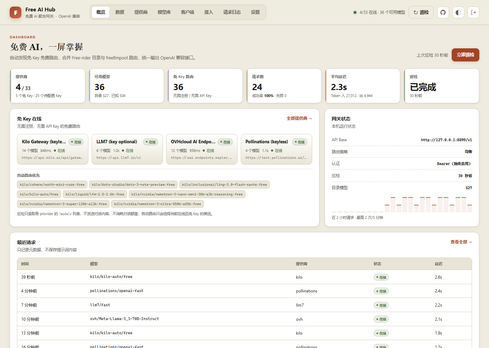
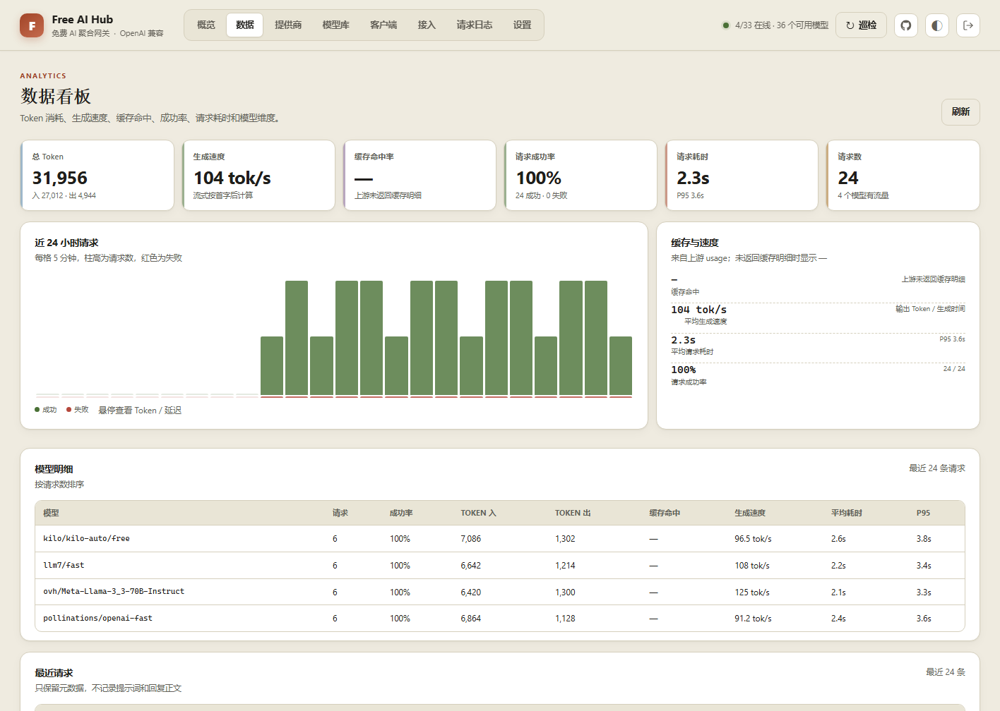
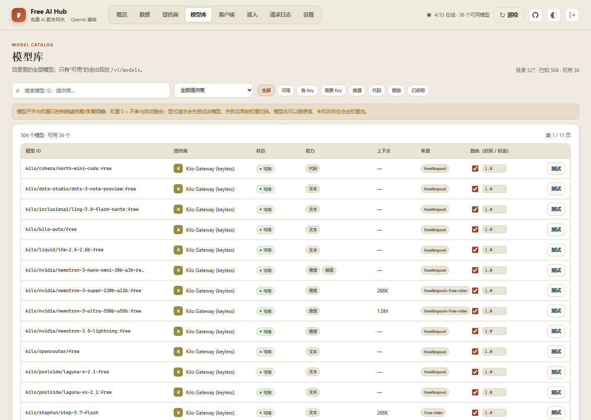
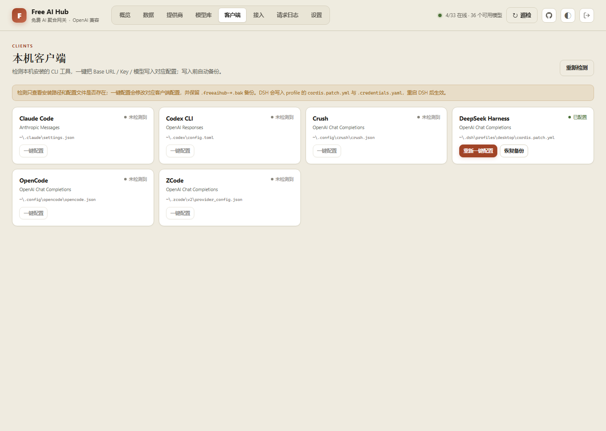

<h1 align="center">Free AI Hub</h1>

<p align="center">
  <strong>本地运行、零本地模型的免费 AI 聚合网关</strong><br>
  OpenAI Chat Completions · OpenAI Responses · Anthropic Messages
</p>

<p align="center">
  <a href="https://www.python.org/"></a>
  <a href="https://flask.palletsprojects.com/"></a>
  <a href="https://www.python-httpx.org/"></a>
  <a href="LICENSE"></a>
  <a href="https://github.com/whortle/free-ai-hub"></a>
</p>

## 项目简介

Free AI Hub 是一个**本地运行、零本地模型**的免费 AI 聚合网关。

它自动巡检免 Key provider，把免费模型整理成统一目录，并以 OpenAI Chat Completions、OpenAI Responses、Anthropic Messages 三种协议对外提供服务。模型名可以任意填写，网关会按权重自动分发，失败时自动切换到下一条可用路由。

- 免 Key 自动发现：Kilo Gateway、LLM7、OVHcloud AI Endpoints、Pollinations
- 三种协议共用同一个 API Key
- 模型库支持启用开关和权重
- 看板包含概览、数据看板、提供商、模型库、客户端、接入、请求日志、设置
- 看板密码默认 `admin`；API Key 首次启动自动生成

## 预览









## 快速开始

### 便携包

解压后双击：

```text
start-free-ai-hub.bat
```

### 源码运行

Python 3.11+：

```powershell
python -m venv .venv
.\.venv\Scripts\Activate.ps1
pip install -r requirements.txt
python run.py
```

启动后：

- 看板：<http://127.0.0.1:8899/>
- API：<http://127.0.0.1:8899/v1>
- 密码：`admin`（登录后可在设置修改）
- API Key：首次启动自动生成，终端和看板「设置」都能看到

## 三种协议

| 协议 | Base URL | Endpoint | Key |
|---|---|---|---|
| OpenAI Chat Completions | `http://127.0.0.1:8899/v1` | `/chat/completions` | `Authorization: Bearer` |
| OpenAI Responses | `http://127.0.0.1:8899/v1` | `/responses` | `Authorization: Bearer` |
| Anthropic Messages | `http://127.0.0.1:8899` | `/v1/messages` | `x-api-key` |

DSH 或其他客户端里，Base URL 填到 `/v1`（Anthropic 只填端口）；模型名填 `auto` 或任意名称。未知名称会走权重池，不再返回 404。

## 客户端一键配置

看板「客户端」页检测本机安装的 CLI，并写入对应配置（写入前自动备份，可恢复）：

| 客户端 | 协议 | 配置 |
|---|---|---|
| Claude Code | Anthropic Messages | `~/.claude/settings.json` |
| Codex CLI | OpenAI Responses | `~/.codex/config.toml` + `auth.json` |
| Crush | OpenAI Chat Completions | `~/.config/crush/crush.json` |
| DeepSeek Harness | OpenAI Chat Completions | `~/.dsh/profiles/*/cordis.patch.yml` + `.credentials.yaml` |
| OpenCode | OpenAI Chat Completions | `~/.config/opencode/opencode.json` |
| ZCode | OpenAI Chat Completions | `~/.zcode/v2/provider_config.json` |

DSH 的 Key 存在 `.credentials.yaml` 的 `refs` 里，模型页的密钥框仍会显示为空，这是 DSH 不回显密钥的安全设计；配置后重启 DSH 即可。

## 模型权重

「模型库」每一行可设置启用开关和权重：

- 权重 `0`：不参与自动分发，显式请求仍会先尝试
- 权重越高，自动选中的概率越大
- 优先分散到不同 provider；请求失败按权重切换下一条
- 权重保存在 `data/model_settings.json`，重启保留

## 数据看板

「数据」页展示：

- 总 Token / 输入 / 输出
- 生成速度（tok/s）
- 缓存命中率（上游未返回缓存明细时显示 `—`）
- 请求成功率
- 平均耗时 / P95 耗时
- 最近 24 小时请求柱状图
- 模型维度明细：请求数、成功率、Token、缓存、速度、耗时
- 最近请求：时间、模型、状态、Token、速度、缓存、耗时

只记录元数据，不保存提示词和回复正文。

## Provider Key（可选）

免 Key 的 4 家开箱即用。需要 Key 的 provider 可以在「提供商」里填写，或设置环境变量：

```powershell
$env:FREEAIHUB_<PROVIDER_ID>_API_KEY = "..."
```

Key 只写入本项目 `data/keys.json` 或当前进程环境变量。

## 安全提示

- 免费 provider 会收到请求，可能记录或审核内容；不要发送机密代码、客户数据、个人信息。
- 免费额度、模型 ID 和可用性随时可能变化，不保证 SLA。
- 公网部署请加反向代理和 TLS；默认只在本机使用。

## 许可证

主要上游是 [freellmpool](https://github.com/0xzr/freellmpool)（MIT），本项目使用其 provider 目录与免费路由设计。许可证副本见 `data/licenses/freellmpool-LICENSE`，详细说明见 [NOTICE](NOTICE)。
